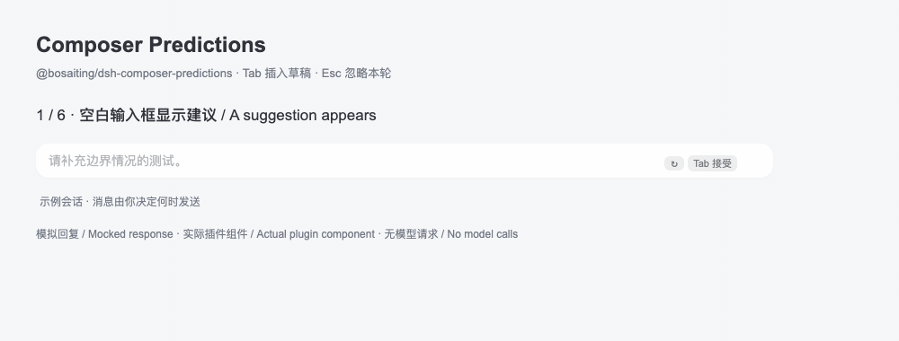

# dsh-composer-predictions

[仓库](https://github.com/Bosaiting/dsh-composer-predictions) · [问题反馈](https://github.com/Bosaiting/dsh-composer-predictions/issues) · [English](README.en.md) · [安装与卸载](docs/INSTALL.md) · [隐私与费用](docs/PRIVACY.md) · [已知问题](docs/KNOWN_ISSUES.md) · [演示与截图](docs/DEMO.md)

为 [DeepSeek Harness](https://github.com/deepseek-ai/deepseek-harness) 的空白输入框预测下一条用户消息。按 **Tab** 插入可编辑草稿，按 **Esc** 忽略本轮建议；接受建议不会自动发送。

这是独立维护的社区插件，与 DeepSeek、OpenAI 均无隶属或背书关系。npm 包名为 **`@bosaiting/dsh-composer-predictions`**。无作用域的同名 npm 包属于其他作者，安装时请核对完整名称。



动图使用实际插件组件和模拟回复，展示临时隐藏、恢复、Tab 插入草稿及 Esc 忽略；没有模型请求。另见[静态预览与真实桌面安装截图](docs/DEMO.md)。

## 功能

- 正常完成一轮对话后，空白输入框显示一条建议，可重新生成。
- 隐藏与忽略分开：输入文字、附件或菜单暂时隐藏建议，清空后可恢复；接受或 Esc 会消耗本轮建议。
- 有效建议可跨会话切换恢复；关闭功能或页面隐藏时停止新的预测请求。
- 设置 → 通用提供开关、最近失败原因、重试和仅计数的本地使用统计。
- 限制上下文消息数和字符数，长消息保留开头与结尾；截断保留组合字符。
- 使用 DSH 模型服务与可撤销插入接口，检测常见输入框建议插件冲突。

## 发布与兼容状态

**当前版本：0.4.3，已在 GitHub Release 和 npm 公开发布。** 发布资产见 [GitHub Release](https://github.com/Bosaiting/dsh-composer-predictions/releases/tag/v0.4.3)，注册表信息见 [npm](https://www.npmjs.com/package/@bosaiting/dsh-composer-predictions)。 0.4.3 修复了输入法期间的键盘接管、初始化补取、冲突误判和前后端超时。未解决问题见 [KNOWN_ISSUES.md](docs/KNOWN_ISSUES.md)。

| 项目 | 范围 |
| --- | --- |
| DSH 声明范围 | `>=0.2.1-rc.2 <0.3.0`，不代表其中每个版本均已测试 |
| 原生接口及样式基线 | DSH `0.2.1-rc.2` |
| 本机手工验收 | macOS `26.4`、DSH `0.2.1-rc.2`、本地定制 Claude-style `0.19.1`；作者确认检查无问题 |
| 开发工具要求 | Node `^22.19.0 \|\| >=24.0.0`；浏览器检查使用 Chromium |
| 界面 | DSH Web 客户端，包括桌面应用的 Web 界面 |

2026-10-26，作者已安装正式 npm 包、重启桌面并确认本机检查无问题。版本标签的 Node 22／24 CI 均通过；npm 包与 Release 安装包逐字节一致，注册表安装与卸载也已验证。其他环境的覆盖范围见[验证记录](docs/VALIDATION.md)，复现方法见[开发说明](docs/DEVELOPMENT.md)。

## 安装

桌面应用打开 **Plugins → Add plugin（插件 → 添加插件）**，输入：

```text
@bosaiting/dsh-composer-predictions@0.4.3
```

核对名称后安装、启用并按提示重启。Web／独立 profile 通过 npm 安装：

```sh
dsh plugin --profile web add @bosaiting/dsh-composer-predictions@0.4.3 --save-exact
```

从本项目早期本地副本升级时，先停用并卸载旧本地包，再安装带作用域的新包。迁移说明见安装文档。

也可以下载 [Release 安装包](https://github.com/Bosaiting/dsh-composer-predictions/releases/tag/v0.4.3)，或从该版本源码生成 `.tgz`：

```sh
git clone --branch v0.4.3 --depth 1 https://github.com/Bosaiting/dsh-composer-predictions.git
cd dsh-composer-predictions
npm pack
```

随后使用生成的安装包。桌面应用中打开 **Plugins → Add plugin（插件 → 添加插件）**，输入安装包的绝对路径，核对包名后安装、启用并按提示重启。

Web／独立 profile 可在安装包所在目录执行：

```sh
dsh plugin --profile web add ./bosaiting-dsh-composer-predictions-0.4.3.tgz
```

`web` 是目标环境名，请替换为实际使用的 profile。桌面 CLI 的支持取决于具体 DSH 发行版，详见 [完整安装、升级与卸载流程](docs/INSTALL.md)。

## 模型、费用与隐私

启用后会自动预测，**会产生额外模型调用**。默认继承会话的 provider、model 和 reasoning effort，不自动选择更便宜的模型或推理强度。所选模型服务会收到预测上下文；插件没有独立遥测服务器。

预测不写入会话事件日志，也不进入会话 token 用量账本，供应商仍可能计费或消耗订阅额度。缓存能减少请求，但不保证供应商命中前缀缓存。详见 [数据与费用说明](docs/PRIVACY.md)。

## 配置与开发

开关位于设置 → 通用 → **Predict next message**。高级配置位于 profile 补丁，见 [配置说明](docs/CONFIGURATION.md)。

```sh
npm ci
npx playwright install chromium
npm run check
npm pack
```

`check` 运行完整检查；`pack` 只执行不需要浏览器、网络或开发依赖的运行文件检查。安装器仍需获取生产依赖。详见 [开发说明](docs/DEVELOPMENT.md) 和 [发布流程](docs/RELEASING.md)。

## 反馈与许可

通过 [GitHub Issues](https://github.com/Bosaiting/dsh-composer-predictions/issues) 反馈问题，附版本和最小复现，先删去密钥、私人路径与会话。见 [CONTRIBUTING.md](CONTRIBUTING.md)。

[MIT](LICENSE)。测试样式快照和依赖来源见 [第三方声明](THIRD_PARTY_NOTICES.md)。
