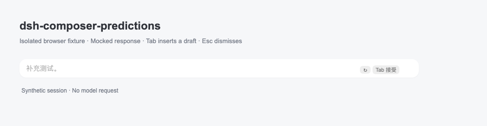
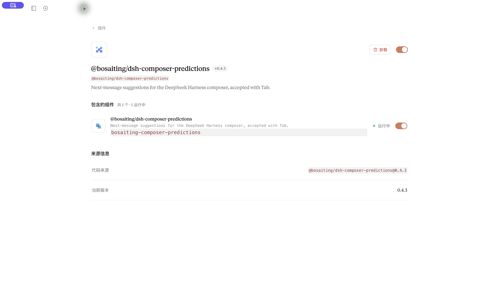

# 演示与截图 / Demo assets

更新日期：2026-10-26。对应正式版本 `@bosaiting/dsh-composer-predictions@0.4.3`。

## 操作演示


动图长 12 秒，共六个画面，使用插件的实际客户端组件、合成会话与模拟模型回复：

| 步骤 | 展示行为 |
| --- | --- |
| 1 | 最近一轮完成后，空白输入框出现灰字建议 |
| 2 | 输入自己的文字，建议暂时隐藏 |
| 3 | 清空文字，恢复原建议 |
| 4 | 按 Tab，将建议插入可编辑草稿；不发送消息 |
| 5 | 下一轮完成后，可以出现新建议 |
| 6 | 按 Esc，忽略当前轮次的建议；普通界面刷新不恢复该条建议 |

Tab 和 Esc 通过实际键盘事件驱动组件，隐藏／恢复和新轮次由夹具更新模拟状态。脚本检查每一步的建议／草稿状态，以及正文、占位提示和灰字建议不会同时叠加。它不读取已有 DSH 数据，不调用模型，也不是原生系统输入法录像。

The animation renders the actual component with synthetic state and mocked responses. Tab inserts a draft; Esc dismisses the current turn. No model requests are made. It is a browser fixture, not a recording of native IME behavior.

[查看静态首帧](images/preview.png)。不方便播放动图时，也可直接查看：



## 正式包的真实桌面安装



这张图直接截自原生 DSH 桌面应用的插件详情：包名、来源和版本为 `@bosaiting/dsh-composer-predictions@0.4.3`，组件已启用且运行中。采集前收起私人会话侧栏，画面不含账户详情、私人路径或会话正文，没有替换或重绘界面文字。

环境为 macOS 26.4、DSH Desktop 0.2.1-rc.2、本地定制 Claude-style 0.19.1。作者随后在本机自行检查并报告没有问题。详细证据与覆盖范围见 [VALIDATION.md](VALIDATION.md)。

The desktop image is a native screenshot of the installed public npm package. Private workspace/session navigation was collapsed before capture. It establishes installation and component status; the animation above explains interaction using mocked data.

## 重建演示

先准备[开发环境](DEVELOPMENT.md)、Playwright Chromium 和 PATH 上的 FFmpeg，然后执行：

```sh
npm run preview
```

脚本重建 `images/preview.png` 和 `images/demo.gif`。FFmpeg 只用于把六张组件截图编码为 GIF，不参与插件运行、安装或常规测试。脚本不会覆盖真实桌面截图。

真实桌面图需要手工更新：打开插件详情并收起会话侧栏，确认只包含可公开的包名、版本、来源和运行状态后截图。不要提交带私人会话、账户、工作路径、密钥或错误原文的画面。演示素材描述的是采集时的版本；更新文档不会改变已经发布的安装包。
